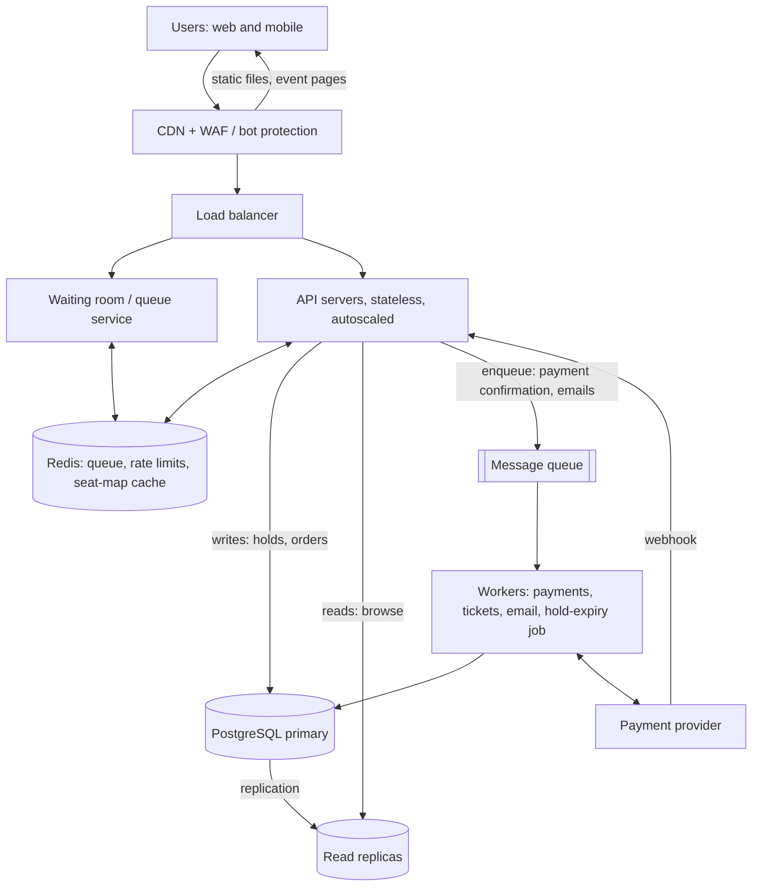

# TicketHub: System Design

TicketHub is a website that sells tickets for concerts and events. This document follows the six-part framework: requirements, estimates, API, data model, architecture, trade-offs. The hardest problem is that a very popular concert puts a huge crowd on a small set of seats, so the design is built around the "big sale" and keeps the normal day cheap.

**Given facts**

- 2 million registered users
- Normal day: 50,000 visitors, 10 page views each, 5,000 tickets sold
- Big sale: 200,000 people try to buy 20,000 seats within the first 10 minutes

---

## 1. Requirements

### Functional

1. Users can register, log in and log out.
2. Users can browse and search events by name, city, date and category.
3. Users can view an event's details and its seat map with live availability and prices.
4. Users can select seats (maximum 4 per order) and place a temporary **hold** on them.
5. Users can pay for held seats and receive a confirmation.
6. Users can view their tickets (with a QR code) and their order history.
7. Holds expire automatically if the user does not pay in time (5 minutes).
8. Admins or organisers can create events and set the seat layout, prices and on-sale time.

### Non-functional

| Quality | Requirement | Why it matters |
|---|---|---|
| **Speed** | Browsing pages return in under 300 ms (p95). Seat map loads in under 500 ms. Placing a hold responds in under 1 s, even during a big sale. | Slow pages during a sale make people refresh, which makes the load worse. |
| **Correctness** | A seat is **never** sold to two people, even if thousands click it in the same millisecond. Money and tickets always agree: no charge without a ticket, no ticket without a charge. | This is the most important rule. An oversold seat means an angry customer at the door and a refund. |
| **Fairness** | People get a chance in the order they arrived. One person cannot grab hundreds of seats, so there is a per-user limit and bot protection. Everyone sees the same on-sale time. | Without this, bots and the fastest connections win, and honest users lose. |
| **Availability** | Browsing stays up at 99.9%. If something fails during a sale, the system fails safe: it refuses requests rather than selling a seat twice. | Correctness is more important than staying up. |
| **Scalability** | Handles the big-sale peak (section 2) without a manual rebuild. It scales up for the sale and back down after. | The peak is hundreds of times normal traffic but lasts minutes. |
| **Durability** | Every confirmed order and ticket survives crashes (replicated database, backups). | A paid ticket must not disappear. |
| **Security** | Passwords are hashed, all traffic is over HTTPS, and card details never touch our servers (a payment provider handles them). | Legal and trust. |

---

## 2. Estimates

### 2.1 Normal day

- **Page views:** 50,000 visitors x 10 pages = **500,000 page views/day**.
- **Average rate:** 500,000 / 86,400 s = about **6 requests/second**.
- **Busy-hour rate:** traffic clusters in the evening. Assuming the peak hour carries 5-10x the average, that is about **30-60 requests/second**.
- **Sales:** 5,000 tickets/day = **0.06 tickets/second** on average. Even at 10x that, it is less than 1 purchase per second.
- **Storage:** 5,000 tickets/day x 365 = about 1.8 million tickets/year. At roughly 200 bytes per row, that is a few hundred MB/year. This is small for one relational database.

### 2.2 Big sale (popular concert goes on sale)

- **Arrival rate:** 200,000 people in 10 minutes (600 s) = **about 333 new users/second** on average. In practice most arrive in the first 30-60 seconds, so the real spike is several times higher.
- **Requests per user:** each person loads the event page, the seat map, then retries and refreshes. Assuming about 20 requests each, that is 200,000 x 20 = 4 million requests in 600 s = about **6,700 requests/second** on average, with spikes of **10,000-20,000/second** in the first minute.
- **Contention:** 200,000 people for 20,000 seats is **10 people per seat**. 90% of buyers will not get a ticket.
- **Hold attempts:** assuming 3 attempts per person, that is 600,000 hold attempts in 10 minutes = about **1,000 hold attempts/second**, all aimed at the same 20,000 rows.
- **Sales rate:** if all 20,000 seats sell out in 10 minutes, that is about **33 tickets/second**.

### 2.3 Comparison

| Measure | Normal day | Big sale | Ratio |
|---|---|---|---|
| Requests/second | about 6 average (30-60 busy hour) | about 6,700 average (10,000-20,000 spike) | **about 100-1,000x** |
| Tickets sold/second | 0.06 | about 33 | **about 500x** |
| Tickets sold in the window | 5,000 per day | 20,000 in 10 minutes | **4 days of sales in 10 minutes** |
| Contention (people per seat) | almost none | 10 per seat | the real problem |

**Conclusion:** the big sale is not just "more of the same". Read traffic grows about 1,000x, but the hard part is that thousands of writes target the same 20,000 seat rows at once. We cannot size the whole system for this peak all year, so we use a waiting room, caching and autoscaling to absorb it for a few minutes.

---

## 3. API

REST over HTTPS, JSON bodies. All endpoints except browsing and login need a bearer token. Money is in cents (integers).

| # | Purpose | Endpoint | Notes |
|---|---|---|---|
| 1 | Browse events | `GET /events?city=&date=&category=&q=&page=` | Public, paginated, cached at the CDN. |
| 2 | Event details | `GET /events/{event_id}` | Public, cached. |
| 3 | View seats | `GET /events/{event_id}/seats?section=` | Returns each seat's `status` (`available`, `held`, `sold`) and price. Served from cache (1-2 s old). |
| 4 | Hold seats | `POST /events/{event_id}/holds` | Body: `{"seat_ids": [101, 102]}`. Returns `201 {hold_id, expires_at}` or `409 {unavailable_seat_ids}`. |
| 5 | Release a hold | `DELETE /holds/{hold_id}` | Frees the seats early. |
| 6 | Pay | `POST /orders` | Body: `{"hold_id": "...", "payment_token": "..."}`. Requires an `Idempotency-Key` header. Returns `202` (processing) then the order is confirmed. |
| 7 | Order status | `GET /orders/{order_id}` | Poll for `pending`, `paid` or `failed`. |
| 8 | View my tickets | `GET /me/tickets` | Returns tickets with seat details and QR code data. |
| 9 | Join the queue | `POST /events/{event_id}/queue` and `GET /events/{event_id}/queue/status` | Only for big sales. Returns the user's position and, when admitted, an `access_token`. |
| 10 | Auth | `POST /auth/register`, `POST /auth/login` | Returns a token. |

**Example: hold seats**

```http
POST /events/42/holds
Authorization: Bearer <token>
Content-Type: application/json

{"seat_ids": [101, 102]}
```

```http
201 Created
{"hold_id": "9f1c...", "expires_at": "2026-10-28T19:05:00Z", "seats": [101, 102]}
```

If someone else got seat 102 first:

```http
409 Conflict
{"error": "seats_unavailable", "unavailable_seat_ids": [102]}
```

The `Idempotency-Key` on `POST /orders` means that if the user's phone retries a slow request, they are charged only once.

---

## 4. Data Model

Relational database (PostgreSQL). The relationships and the constraints are what keep the data correct.

### 4.1 Tables

**users**

| Column | Type | Notes |
|---|---|---|
| id | bigint PK | |
| email | text | **UNIQUE**, not null |
| name | text | |
| password_hash | text | |
| created_at | timestamptz | |

**events**

| Column | Type | Notes |
|---|---|---|
| id | bigint PK | |
| name | text | |
| venue | text | |
| starts_at | timestamptz | |
| on_sale_at | timestamptz | When tickets go on sale |
| status | text | `draft`, `on_sale`, `sold_out`, `cancelled` |

**seats** (one row per physical seat per event)

| Column | Type | Notes |
|---|---|---|
| id | bigint PK | |
| event_id | bigint | FK to events.id |
| section, row_label, seat_number | text/int | **UNIQUE (event_id, section, row_label, seat_number)** |
| price_cents | int | |
| status | text | `available`, `held`, `sold`. CHECK constraint limits it to these values. |
| hold_id | uuid | FK to holds.id, null unless held |
| held_until | timestamptz | Copy of the hold's expiry, so the hold query needs no join |

**holds** (a temporary reservation of one or more seats)

| Column | Type | Notes |
|---|---|---|
| id | uuid PK | |
| user_id | bigint | FK to users.id |
| event_id | bigint | FK to events.id |
| expires_at | timestamptz | created_at + 5 minutes |
| state | text | `active`, `converted`, `released`, `expired` |

**orders**

| Column | Type | Notes |
|---|---|---|
| id | bigint PK | |
| user_id | bigint | FK to users.id |
| hold_id | uuid | FK to holds.id, **UNIQUE** (one order per hold) |
| total_cents | int | |
| status | text | `pending`, `paid`, `failed`, `refunded` |
| idempotency_key | text | **UNIQUE** per user |
| payment_ref | text | Reference from the payment provider |
| created_at | timestamptz | |

**tickets** (one row per seat sold)

| Column | Type | Notes |
|---|---|---|
| id | bigint PK | |
| order_id | bigint | FK to orders.id |
| seat_id | bigint | FK to seats.id |
| status | text | `valid`, `cancelled` |
| qr_code | text | |
| | | **UNIQUE (seat_id) WHERE status = 'valid'**: a partial unique index |

### 4.2 Relationships

- One **user** has many **holds** and many **orders** (1:N).
- One **event** has many **seats** (1:N); a seat belongs to exactly one event.
- One **hold** covers many **seats** (1:N through `seats.hold_id`) and results in at most one **order** (1:1).
- One **order** has many **tickets** (1:N), and each **ticket** points to exactly one **seat**. A seat has at most one *valid* ticket (enforced by the partial unique index).

```
users 1---N holds 1---N seats N---1 events
  |          |            |
  |          1            1
  N          |            |
orders 1-----+            N
  |                       |
  1                       |
  N                       |
tickets N-----------------1 (seat_id)
```

### 4.3 How double-booking is prevented

The rule is: **a seat can only be given to one person, and the database, not the application, is the one that enforces it.** There are three layers, so that a bug or a race in one layer is still caught by the next.

**Layer 1: an atomic conditional hold (transaction).** Holding seats runs in one transaction. The check ("is it free?") and the change ("take it") are a single `UPDATE` statement, so there is no gap between them for another user to slip into:

```sql
BEGIN;

UPDATE seats
SET    status = 'held', hold_id = :hold_id, held_until = now() + interval '5 minutes'
WHERE  event_id = :event_id
  AND  id = ANY(:seat_ids)
  AND  (status = 'available'
        OR (status = 'held' AND held_until < now()));   -- an expired hold can be taken

-- Application checks the row count:
--   rows updated = number of seats requested  -> COMMIT  (all seats are ours)
--   rows updated < number requested           -> ROLLBACK (return 409; take none)
```

When two users run this at the same moment for the same seat, PostgreSQL locks the row for the first one. The second waits, then re-checks the `WHERE` condition, finds the status is now `held`, and updates **0 rows**. The second user therefore gets a clean `409`. The all-or-nothing rollback also means nobody ends up holding half of the seats they wanted. To avoid deadlocks when two users pick overlapping seats, the application always locks seats in ascending `id` order.

**Layer 2: re-verify when paying (transaction + row locks).** After payment succeeds, one transaction does:

```sql
BEGIN;
SELECT id FROM seats
WHERE  hold_id = :hold_id AND status = 'held' AND held_until >= now()
FOR UPDATE;                                   -- lock the seats we are about to sell
-- must return exactly the number of seats in the hold, otherwise ROLLBACK and refund

UPDATE seats   SET status = 'sold' WHERE hold_id = :hold_id;
UPDATE orders  SET status = 'paid' WHERE id = :order_id;
INSERT INTO tickets (order_id, seat_id, ...) SELECT ... FROM seats WHERE hold_id = :hold_id;
UPDATE holds   SET state = 'converted' WHERE id = :hold_id;
COMMIT;
```

Because seats, order and tickets change in one transaction, the data is either all updated or not at all (atomicity). There is never a paid order without tickets. If the check finds a seat is no longer ours (for example the hold expired and someone else took it), the transaction is rolled back and the payment is automatically refunded.

**Layer 3: a database constraint as the safety net.** Even if application code had a bug, the partial unique index `UNIQUE (seat_id) WHERE status = 'valid'` on `tickets` makes it **impossible to insert a second valid ticket for the same seat**. The second insert fails and its transaction rolls back. The unique constraint on `seats (event_id, section, row_label, seat_number)` also stops duplicate seat rows from being created, and the `CHECK` on `status` stops invalid states.

**Supporting rules**

- **Holds expire:** a background job sets expired holds to `expired` and their seats back to `available`. The hold query in Layer 1 also accepts an expired hold directly, so correctness never depends on the job running on time.
- **Payment race:** when payment starts, the hold is extended by 2 minutes and is not released by the cleanup job while the order is `pending`. This stops a seat from being resold while a payment is in flight.
- **Idempotency:** the unique `idempotency_key` means a retried request returns the same order instead of creating a second one.
- **The cache is never the authority:** the seat map shown to users may be a second or two out of date, but a click always goes to the database, which decides. A stale "available" seat just leads to a harmless `409`.

---

## 5. Architecture



### Components

| Component | What it does | How it helps during the big sale |
|---|---|---|
| **CDN + WAF** | Serves images, JavaScript and cached event pages from servers close to users (including Nairobi and other regions). The web application firewall blocks bots and floods. | Most of the 4 million requests never reach our servers. It also blocks the bots that unfair buyers rely on. |
| **Load balancer** | Spreads requests across API servers and removes unhealthy ones. | No single server is overloaded. |
| **Waiting room / queue service** | For a big sale, users join an orderly virtual queue. Only a controlled number (for example 2,000 at a time) are admitted to the buying flow, each with a signed access token. | It turns 200,000 simultaneous users into a steady flow the database can handle. It is also the fairness mechanism: users are admitted in the order they joined. |
| **API servers** | Stateless services that handle browsing, holds, orders and tickets. No data is kept in memory, so more copies can be added or removed freely. | They autoscale ahead of the sale (scheduled, because we know the on-sale time) and scale back down after. |
| **Redis** | Holds the queue, per-user rate limits, and a short-lived (1-2 s) copy of each event's seat map. | Thousands of people looking at the seat map are answered from memory instead of the database. |
| **PostgreSQL primary** | The single source of truth for seats, holds, orders and tickets. All writes go here, and it enforces the constraints from section 4.3. | One writer for the seat rows is what makes "no double-booking" simple and certain. Admission control keeps its load within what it can handle (about 1,000 hold attempts/second is well within a single tuned Postgres). |
| **Read replicas** | Copies of the database that serve browsing and "my tickets". | Read traffic does not compete with seat writes. |
| **Message queue + workers** | Payment confirmation, ticket generation, QR codes and emails run asynchronously. A scheduled worker also expires old holds. | A slow email or payment provider cannot slow down the hold and buy path. If workers lag, tickets still arrive, just a few seconds later. |
| **Payment provider** | Takes the card or mobile-money payment and calls our webhook with the result. | Card data never touches our system. Idempotency keys make retries safe. |

### How it survives the big sale

1. **Before the sale:** the event page, images and details are cached at the CDN. API servers and the cache are scaled up on a schedule. The queue opens a few minutes before `on_sale_at`.
2. **At the moment of sale:** the 200,000 users hit the CDN and the queue, not the database. The waiting room admits a controlled number at a time, so the peak of 10,000-20,000 requests/second is mostly absorbed by the CDN and Redis.
3. **Buying:** admitted users read the seat map from the cache and send holds to the database. Atomic conditional updates give each seat to exactly one person, and everyone else gets a fast `409` and picks another seat.
4. **Payment:** handled asynchronously through the queue. Seats stay safely held while payment is in progress.
5. **Sold out:** when the last seat is sold, the event is marked `sold_out`, the cache shows it, and users still in the queue are told immediately instead of waiting for nothing.
6. **Failure behaviour:** if the cache fails, requests fall back to the database at the admitted rate. If the database becomes overloaded, the waiting room slows admissions. In every case the system is allowed to get slower or refuse requests, but it is never allowed to sell a seat twice.

---

## 6. Trade-offs

**1. Strong consistency (one relational primary database) vs. unlimited horizontal scale.**
We keep seats in a single PostgreSQL primary so that transactions and unique constraints give us a hard guarantee against double-booking. The cost is that writes cannot be spread across many machines the way they could with a sharded or eventually-consistent NoSQL store. We accept this because the numbers allow it (about 1,000 hold attempts/second and 33 sales/second for one event), and because for tickets, being correct matters more than being infinitely scalable. If we later have many huge events at once, we can shard by `event_id`, because seats for different events never interact.

**2. Waiting room (fairness and stability) vs. user experience and speed.**
The queue protects the database and gives everyone an orderly turn, but people must wait, and some will give up or be annoyed to see "you are number 84,000". Without it, the site would crash or the fastest bots would win. We choose the queue for big sales only, and keep the normal flow (no queue) for ordinary days.

**3. Short-lived cached seat map vs. perfectly accurate availability.**
Serving the seat map from a 1-2 second cache makes browsing fast and cheap, but a user may click a seat that was just taken and get a `409`. This is acceptable because the database is the real authority, the failure is harmless, and the UI can simply refresh and show the seat as unavailable.

**4. Timed holds (5 minutes) vs. maximum seat utilisation.**
Holds make checkout fair (nobody loses their seat while typing card details), but abandoned holds block seats for up to 5 minutes, which can make a nearly sold-out event look full when seats will soon return. A shorter hold sells seats faster but pressures slow payers (for example mobile-money users waiting for a prompt). We chose 5 minutes, extended by 2 minutes once payment starts.

**5. Asynchronous payment confirmation vs. instant feedback.**
Using a queue and webhooks keeps the buy path fast and resilient, but the user sees "processing" for a few seconds instead of an immediate answer. We accept the small delay in return for reliability, and use the idempotency key so that nobody is charged twice.
