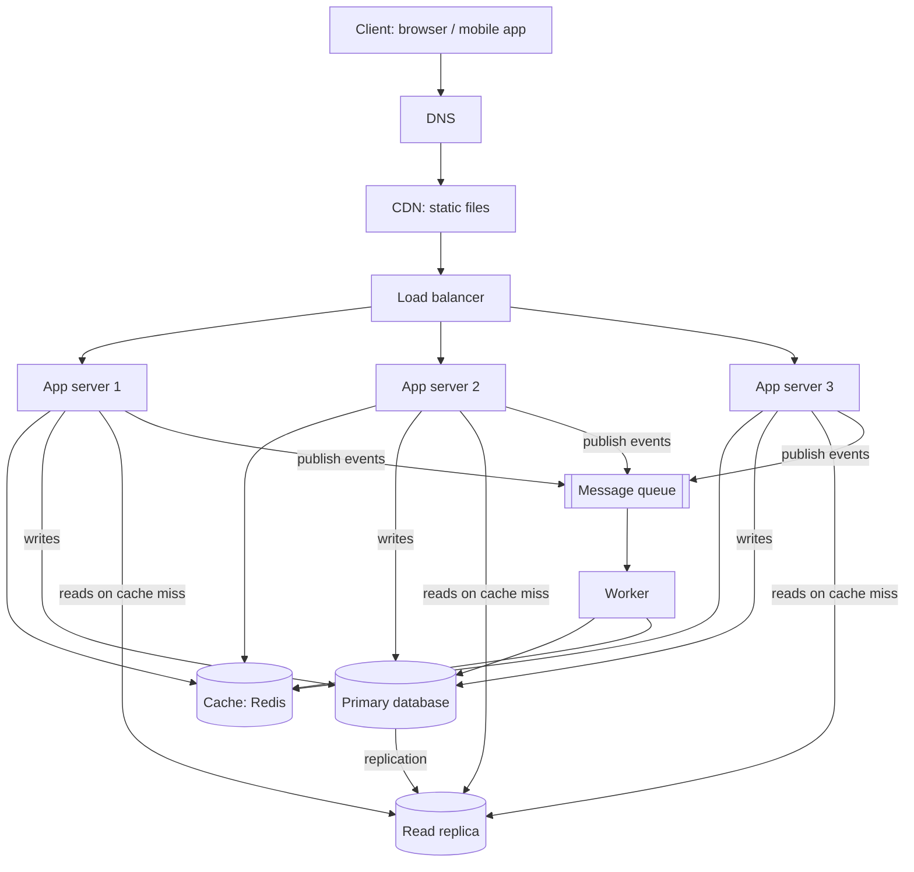

# QuickNotes Architecture

Goal: move QuickNotes from a browser-only app to an online service for **1 million users**.

## Requirements

### Functional
- Register and log in
- Create, read, update and delete notes
- Organise notes with tags and filter by tag
- Notes are available from any device after login

### Non-functional
- **Availability:** 99.9% uptime (no single point of failure)
- **Latency:** list and read requests under 200 ms at the 95th percentile
- **Scalability:** handle 1 million users and grow without a rewrite
- **Durability:** a saved note is never lost (replication and daily backups)
- **Security:** HTTPS everywhere, hashed passwords, per-user data isolation
- **Consistency:** a user sees their own note immediately after saving it

## Load estimate (1 million users)

Assumptions: 30% of users are active on a given day (300,000 daily active users), each reads notes 20 times a day and creates or edits 3 notes a day; a note with metadata and indexes takes about 1 KB; peak traffic is 3 times the average.

| Metric | Calculation | Result |
|--------|-------------|--------|
| Reads per day | 300,000 x 20 | 6,000,000 |
| **Reads per second (average)** | 6,000,000 / 86,400 | about 70 /s |
| Reads per second (peak, x3) | 70 x 3 | about 210 /s |
| Writes per day | 300,000 x 3 | 900,000 |
| **Writes per second (average)** | 900,000 / 86,400 | about 10 /s |
| Writes per second (peak, x3) | 10 x 3 | about 30 /s |
| New notes per year | 900,000 x 365 | about 328 million |
| **Storage per year** | 328 million x 1 KB | about 330 GB (about 0.5 TB with extra indexes headroom) |

The system is **read-heavy (about 7 reads for every write)**, which is why caching and read replicas pay off. These numbers are modest: a single database server could cope today, but we still design for redundancy and growth.

## Architecture diagram

## Components: the problem each one solves

- **Client:** gives users the interface and talks to the API over HTTPS.
- **DNS:** turns the name `api.quicknotes.example` into the address of the load balancer, so servers can change without users noticing.
- **CDN:** serves static files (HTML, CSS, JS, images) from locations near the user, which reduces latency and takes load off our servers.
- **Load balancer:** spreads requests across the app servers, removes unhealthy ones automatically, and stops any one server being overloaded.
- **App servers (3, stateless):** run the API logic; because they hold no session state, we scale by simply adding more, and losing one does not matter.
- **Cache (Redis):** keeps frequently read notes in memory, so most reads skip the database and answer in about a millisecond.
- **Primary database (PostgreSQL):** the single source of truth that accepts all writes with transactional guarantees.
- **Read replica:** a live copy of the primary that serves read queries, which spreads the read load and holds a ready copy if the primary fails.
- **Message queue:** lets the API answer immediately and hand slow or non-critical jobs to be done later, absorbing traffic spikes.
- **Worker:** takes jobs from the queue (clean-up, search indexing, emails, cache refresh) so they never slow down user requests.

## Request flows

### GET /notes
1. The client resolves the API name via **DNS** and sends `GET /v1/notes` over HTTPS (static assets come from the **CDN**).
2. The **load balancer** picks a healthy **app server**.
3. The app server checks the JWT and reads the user id.
4. It looks up the key `notes:user:17:page1` in the **cache**.
5. **Cache hit:** return the JSON immediately (`200 OK`).
6. **Cache miss:** query the **read replica** (using the `user_id, created_at` index), save the result in the cache with a short TTL (for example 60 seconds), and return `200 OK`.

### POST /notes
1. The client sends `POST /v1/notes` with the JSON body; DNS and the **load balancer** route it to an **app server**.
2. The app server validates the token and the input (title required, 100 characters maximum); invalid input gets `400`.
3. It inserts the note, and its tags, into the **primary database** in one transaction.
4. It deletes the user's cached list (`notes:user:17:*`) so the next read is fresh.
5. It publishes a `note.created` event to the **queue**.
6. It returns `201 Created` with the new note. The user never waits for step 7.
7. A **worker** consumes the event and does the follow-up work (search indexing, notifications, usage statistics), retrying if it fails.

## Trade-offs

1. **Cache speed versus freshness.** Caching makes reads very fast but a cached list may be briefly out of date. We accept this by using a short TTL and by deleting the user's cache entries on every write, so the user's own changes show up immediately.
2. **Read replica lag.** Replication is asynchronous, so a replica can be a few hundred milliseconds behind. We accept this for normal reads, but right after a write the app reads that user's data from the primary ("read your own writes") so they never see their note missing.
3. **Queue: responsiveness versus immediacy.** Background work is eventually consistent (a new note may take a few seconds to be searchable), but writes stay fast and the system survives traffic spikes.
4. **SQL consistency versus easy horizontal scaling.** We chose PostgreSQL for integrity and simplicity. Only the primary accepts writes, which is fine at about 30 writes per second; if we outgrow it we can shard by `user_id`.

## Avoiding single points of failure

| Component | How it is protected |
|-----------|---------------------|
| DNS | Managed DNS provider with several name servers |
| CDN | Globally distributed by design |
| Load balancer | Run two or more (managed, multi-zone, or active-passive pair with a shared virtual IP) |
| App servers | Three or more, stateless, in different availability zones; the load balancer's health checks skip failed ones |
| Cache | Redis with a replica and automatic failover; if the cache is down the app falls back to the database (slower, but working) |
| Primary database | Replica in another zone can be promoted automatically if the primary fails; continuous backups and daily snapshots |
| Queue | Managed or clustered queue with persistent messages, so jobs survive restarts; workers run as several instances |
| Worker | More than one instance; a job that fails is retried and can go to a dead-letter queue |
